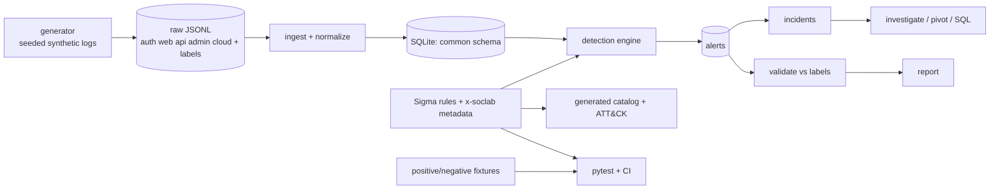

# SOC Detection Lab

[](https://github.com/5exclamations/soc-detection-lab/actions/workflows/ci.yml)

A defensive security-operations lab: it generates **synthetic** logs, normalizes them into one schema, runs Sigma-style detections with correlation, produces alerts and incidents, scores the detections against labeled scenarios, and supports investigation with SQL and CLI pivots. Built to show detection-engineering practice end to end: rule authoring, tests, tuning, documentation and honest measurement.

> **Synthetic results are not real-world performance.** The data and the rules were written by the same person, in one lab, over three simulated days. The precision/recall below show the rules behave as designed on that data. They say nothing about how they would perform against production traffic or real adversaries.

## Quick start
```bash
make setup && make lab      # generate -> ingest -> detect -> validate
make test                   # 98 tests
docker compose up --build   # runs the pipeline in a container (see Docker below)
python -m soclab alerts --id ALR-0013
python -m soclab investigate INC-0022
```

## Architecture

More detail: [docs/architecture.md](docs/architecture.md).

## Log ingestion pipeline
Five sources with deliberately different native shapes (SSO auth, nginx-style web, API gateway, admin audit, CloudTrail-like). `soclab/normalize.py` maps each to a common schema (`soclab/schema.py`): UTC timestamps from ISO strings or epoch, `user`, `src_ip`, `http_*`, `api_key_id`, `cloud_event`, plus fields derived at ingest (`hour_utc`, `self_action`, `public_exposure`). Malformed lines are quarantined to `ingest_errors` instead of failing the run (the generator injects two).

## Detection engine design
- Rules are Sigma-style YAML in `rules/`, evaluated by `soclab/sigma.py` (matcher) and `soclab/engine.py` (correlation).
- Correlations: `event_count`, `value_count`, `temporal_ordered`, with burst merging so a continuing attack is one alert.
- Alerts carry severity (rule level, +1 for privileged accounts where opted in), a templated explanation, evidence IDs and sample, timeline, ATT&CK tags, runbook link.
- Incidents group alerts sharing a user, external IP or API key within two hours; three or more tactics raises severity.
- Sigma compatibility and what is *not* supported: [docs/sigma-compatibility.md](docs/sigma-compatibility.md).

## Detection coverage
| ID | Title | Severity | Type | Techniques | Status |
|---|---|---|---|---|---|
| SOC-API-001 | API Enumeration - High Rate of Authorization or Not-Found Errors | medium | correlation | T1595 | stable |
| SOC-API-002 | Large API Data Export | high | detection | T1213 | stable |
| SOC-API-003 | API Key Used From Multiple Source Addresses | high | correlation | T1550.001 | experimental |
| SOC-AUTH-001 | Excessive Authentication Failures Against One Account | medium | correlation | T1110.001 | stable |
| SOC-AUTH-002 | Password Spraying - Many Accounts From One Source | high | correlation | T1110.003 | stable |
| SOC-AUTH-003 | Successful Login Following a Failure Burst | high | correlation | T1078, T1110 | stable |
| SOC-AUTH-004 | Successful Logins From Multiple Countries Within One Hour | medium | correlation | T1078 | experimental |
| SOC-AUTH-005 | Privileged Account Login Outside Business Hours | medium | detection | T1078 | experimental |
| SOC-CLOUD-001 | Cloud Audit Logging Disabled or Deleted | critical | detection | T1685.002 | stable |
| SOC-CLOUD-002 | Cloud Console Login Without MFA | high | detection | T1078.004 | stable |
| SOC-CLOUD-003 | Cloud IAM Administrative Policy Attached or Access Key Created For Another Principal | high | detection | T1098.001, T1098.003 | stable |
| SOC-CLOUD-004 | Storage Bucket Policy or ACL Grants Public Access | high | detection | T1530 | stable |
| SOC-PRIV-001 | Privileged Role or Group Granted Without Change Ticket | high | detection | T1098 | stable |
| SOC-PRIV-002 | Sudoers Modified Without Change Ticket | high | detection | T1548.003 | stable |
| SOC-WEB-001 | Web Content Discovery - Many Distinct 404 Paths | low | correlation | T1595.003 | stable |
| SOC-WEB-002 | Web Request Containing Traversal or Injection Markers | medium | detection | T1190 | stable |
| SOC-WEB-003 | Successful Admin Panel Access From Outside Internal Ranges | high | detection | T1078 | stable |

ATT&CK mapping table and Navigator layer (ATT&CK Enterprise v19.2, layer format 4.5): [docs/mitre-mapping.md](docs/mitre-mapping.md), `reports/attack-navigator-layer.json`; see *ATT&CK validation* below. Full per-rule logic, false positives, tuning and limitations: [docs/detection-catalog.md](docs/detection-catalog.md).

**Gaps (known, measured or by design):** low-and-slow and distributed password guessing (both missed in the evaluation), no baselining of per-user behaviour, no endpoint/network telemetry, no lateral-movement or exfiltration-volume detections beyond a static size threshold. See [docs/limitations.md](docs/limitations.md).

## Evaluation: what is counted
Ground truth comes from the generator: every scenario is *attack*, *evasion* (attack designed to evade) or *hard_negative* (benign activity that looks suspicious). Each malicious event lists the rules that should detect it.

| Term | Definition | Unit |
|---|---|---|
| True-positive alert | Alert whose evidence includes a malicious event that lists that alert's rule as expected | alert |
| False-positive alert | Any other alert: hard-negative scenario, unlabeled baseline traffic, or a rule that was not expected on an attack event | alert |
| Detected pair | An expected (scenario, rule) pair matched by at least one TP alert | pair |
| False negative | An expected (scenario, rule) pair with no TP alert | pair |
| Scenario TP / FN / FP / TN | Malicious scenario with a detected pair / without / benign scenario with any overlapping alert / without | scenario |

Precision = TP alerts / all alerts. Recall = detected pairs / expected pairs. Because the units differ, a single scenario-level confusion matrix (one unit, four cells) is also reported. Several alerts for one pair (single-event rules fire once per event) inflate TP alerts but not detected pairs; this is intentional and documented. Tests in `tests/test_metrics.py` pin these definitions against hand-computed cases.

```
|---|---|---|---|---|---|---|
| SOC-API-001 | 1 | 0 | 1 | 0 | 1.0 | 1.0 |
| SOC-API-002 | 6 | 0 | 2 | 0 | 1.0 | 1.0 |
| SOC-API-003 | 1 | 1 | 1 | 0 | 0.5 | 1.0 |
| SOC-AUTH-001 | 3 | 1 | 5 | 2 | 0.75 | 0.6 |
| SOC-AUTH-002 | 1 | 0 | 1 | 0 | 1.0 | 1.0 |
| SOC-AUTH-003 | 3 | 1 | 3 | 0 | 0.75 | 1.0 |
| SOC-AUTH-004 | 2 | 1 | 2 | 0 | 0.667 | 1.0 |
| SOC-AUTH-005 | 2 | 1 | 2 | 0 | 0.667 | 1.0 |
| SOC-CLOUD-001 | 2 | 0 | 2 | 0 | 1.0 | 1.0 |
| SOC-CLOUD-002 | 2 | 0 | 2 | 0 | 1.0 | 1.0 |
| SOC-CLOUD-003 | 4 | 0 | 2 | 0 | 1.0 | 1.0 |
| SOC-CLOUD-004 | 1 | 0 | 1 | 0 | 1.0 | 1.0 |
| SOC-PRIV-001 | 2 | 0 | 2 | 0 | 1.0 | 1.0 |
| SOC-PRIV-002 | 1 | 0 | 1 | 0 | 1.0 | 1.0 |
| SOC-WEB-001 | 1 | 0 | 1 | 0 | 1.0 | 1.0 |
| SOC-WEB-002 | 6 | 0 | 1 | 0 | 1.0 | 1.0 |
| SOC-WEB-003 | 5 | 0 | 2 | 0 | 1.0 | 1.0 |

## False positives

- ALR-0001 SOC-AUTH-005: hard_negative:HN-04
- ALR-0019 SOC-AUTH-001: hard_negative:HN-02
- ALR-0020 SOC-AUTH-003: hard_negative:HN-02
- ALR-0025 SOC-API-003: hard_negative:HN-08
- ALR-0026 SOC-AUTH-004: hard_negative:HN-03

## False negatives

- EVA-01 (evasion): SOC-AUTH-001
- EVA-02 (evasion): SOC-AUTH-001
```

## Genuine terminal examples
Alert detail (`python -m soclab alerts --id ALR-0013`):
```
ALR-0013 [CRITICAL] SOC-CLOUD-003 2026-03-02T18:33:00Z  Cloud IAM Administrative Policy Attached or Access Key Created For Another Principal
  adm-jlee performed CreateAccessKey affecting svc-backup from 203.0.113.201 at 2026-03-02T18:33:00Z. 
  MITRE: {'techniques': ['T1098.001', 'T1098.003'], 'tactics': ['persistence', 'privilege-escalation']} 
  Runbook: docs/runbooks/cloud.md#soc-cloud-003
    2026-03-02T18:33:00Z cloud-000069 CreateAccessKey user=adm-jlee ip=203.0.113.201 target=svc-backup mfa=0 error=None
```
Start of the multi-stage incident (`python -m soclab investigate INC-0022`; full output in [docs/investigations/chain-01-output.txt](docs/investigations/chain-01-output.txt)):
```
INC-0022 [CRITICAL] 2026-03-04T02:10:00Z -> 2026-03-04T02:45:00Z  (multi-tactic activity (6 tactics))
Tactics: collection, credential-access, defense-impairment, initial-access, persistence, privilege-escalation 
Entities: {"src_ip": ["203.0.113.50"], "user": ["adm-mpatel"], "target": ["svc-backup2"], "api_key_id": ["key-mpatel-new"]}

Timeline:
  2026-03-04T02:10:00Z auth-000437 login failure user=adm-mpatel ip=203.0.113.50 country=RO mfa=1 <= SOC-AUTH-001,SOC-AUTH-003
  2026-03-04T02:10:15Z auth-000438 login failure user=adm-mpatel ip=203.0.113.50 country=RO mfa=1 <= SOC-AUTH-001,SOC-AUTH-003
  2026-03-04T02:10:30Z auth-000439 login failure user=adm-mpatel ip=203.0.113.50 country=RO mfa=1 <= SOC-AUTH-001,SOC-AUTH-003
  2026-03-04T02:10:45Z auth-000440 login failure user=adm-mpatel ip=203.0.113.50 country=RO mfa=1 <= SOC-AUTH-001,SOC-AUTH-003
  2026-03-04T02:11:00Z auth-000441 login failure user=adm-mpatel ip=203.0.113.50 country=RO mfa=1 <= SOC-AUTH-001,SOC-AUTH-003
  2026-03-04T02:11:15Z auth-000442 login failure user=adm-mpatel ip=203.0.113.50 country=RO mfa=1 <= SOC-AUTH-001,SOC-AUTH-003
  2026-03-04T02:12:00Z auth-000445 login failure user=adm-mpatel ip=203.0.113.50 country=RO mfa=1 <= SOC-AUTH-001
  2026-03-04T02:12:15Z auth-000446 login failure user=adm-mpatel ip=203.0.113.50 country=RO mfa=1 <= SOC-AUTH-001,SOC-AUTH-003
  2026-03-04T02:12:30Z auth-000447 login failure user=adm-mpatel ip=203.0.113.50 country=RO mfa=1 <= SOC-AUTH-001,SOC-AUTH-003
```

## Investigation walkthroughs and runbooks
- Walkthrough: [docs/investigations/chain-01.md](docs/investigations/chain-01.md) (guess admin password -> admin console -> backdoor role -> cloud tampering -> bulk export)
- Triage runbooks: [authentication](docs/runbooks/authentication.md), [privilege](docs/runbooks/privilege.md), [web](docs/runbooks/web.md), [api](docs/runbooks/api.md), [cloud](docs/runbooks/cloud.md)
- [Incident response procedure](docs/incident-response.md) · [False-positive analysis](docs/false-positive-analysis.md)
- SQL hunting queries: `sql/`

## Docker
```bash
docker compose up --build          # service "lab": generate, ingest, detect, validate
docker compose --profile test run --rm test   # service "test": pytest
```
Outputs land in `./data` and `./reports` (git-ignored).

_Verified 2026-10-09 on Windows 10 + Docker Desktop (Engine 29.7.2): `docker compose config`, `docker compose up --build` (service exits 0, full pipeline output, 48 alerts / 24 incidents) and `docker compose --profile test run --rm test` (98 passed). The same steps run in CI (`docker` job)._

## CI
`.github/workflows/ci.yml` runs on every push/PR. Job `test`: `pytest` (per-rule positive/negative fixtures, rule metadata lint, pipeline, metric definitions and regression gate on `tests/expected_metrics.json`, ATT&CK mapping and Navigator-layer checks, documentation freshness), `scripts/validate_sigma.py` (official pySigma parser and validators), `soclab attack-check`, the end-to-end pipeline, and a check that generated docs and the Navigator layer are not stale. Job `docker`: `docker compose config`, `docker compose up --build --exit-code-from lab`, and the test profile.

## ATT&CK validation
Technique IDs and tactic tags were checked against the official MITRE `attack-stix-data` Enterprise catalog (**v19.2**, modified 2026-08-05). Findings and fixes:

| Finding | Fix |
|---|---|
| T1562.008 (SOC-CLOUD-001) is **revoked**; replaced by T1685.002 "Disable or Modify Cloud Log" | Rule re-mapped to T1685.002 |
| Tactic `defense-evasion` no longer exists in v19 (split into `stealth` and `defense-impairment`) | SOC-CLOUD-001 tagged `defense-impairment` |
| SOC-API-003 tagged credential-access/defense-evasion, but T1550.001 belongs to lateral-movement only | Tag corrected to `lateral-movement` |
| SOC-API-001 tagged `discovery`, but T1595 is reconnaissance only | Tag removed |
| Navigator layer carried placeholder `attack: "16"` | Layer now `attack 19`, navigator 5.3.2, layer format 4.5 |

All 16 technique IDs are active (not revoked/deprecated) in v19.2 and every tactic tag is a tactic of its technique. This is enforced offline by `python -m soclab attack-check` and `tests/test_attack.py` against a pinned subset (`soclab/data/attack_enterprise_subset.json`); `python -m soclab attack-check --stix enterprise-attack.json` re-checks against a freshly downloaded full catalog. The layer is structurally validated against the v4.5 format; **it has not been imported into the Navigator web UI**.

## Sigma compatibility (summary)
- **Demonstrated:** all 23 rule documents (17 alerting + helper selections, including the `correlation:` documents) parse in **pySigma 1.5.1** with 0 errors, and pass all of pySigma's validators (30; `attacktag` skipped because it fetches ATT&CK online - covered by the check above) with 0 issues: `python scripts/validate_sigma.py`.
- **Not demonstrated:** conversion with a pySigma backend/pipeline, execution on a real SIEM, or any official Sigma test suite. The lab uses its own field schema, so rules need field mapping before use elsewhere. Correlation semantics (burst merging, group-by constraints) and `x-soclab` metadata are lab extensions.
- Feature-by-feature table: [docs/sigma-compatibility.md](docs/sigma-compatibility.md). This is a **Sigma-style subset**, not claimed to be a conformant Sigma implementation.

## Verified results (2026-10-09) vs. not verified
| Item | Status |
|---|---|
| `pytest` | **98 passed** locally (Windows, Python 3.12) and in the Docker `test` profile (91 original + 7 new regression tests) |
| Pipeline generate -> ingest -> detect -> validate | Reproduced locally and in Docker: 48 alerts, 24 incidents; precision 43/48 = 0.896; pair recall 29/31 = 0.935; scenario matrix TP 13 / FN 2 / FP 4 / TN 6 |
| Docker Compose (`up --build`, test profile) | Verified, see Docker |
| Sigma syntax (pySigma) / ATT&CK v19.2 mappings | Verified, see above |
| GitHub Actions | See the CI badge; status at the commit is recorded in the final report |
| Detection quality on real data | **Not verified** - no real logs were used |
| Navigator UI import, SIEM backend conversion | **Not verified** |

## Technical decisions
- **SQLite + Python stdlib**: zero-infrastructure and reproducible; SQL is first-class for hunting.
- **Own Sigma-subset engine** instead of pySigma: the lab needs correlation semantics and explainable evidence that a conversion-to-SIEM backend would hide. Cost: not portable; documented.
- **Generator with labels** over public datasets: exact ground truth, planted hard negatives and evasions, no real data.
- **Fixtures per rule (positive + near-miss negatives)**: a rule change that breaks a boundary fails CI; metric gate forces deliberate updates.
- **Known FPs and FNs are kept** rather than tuned away, to show trade-offs.

## Interview talking points
- Why event_count/value_count/temporal_ordered, and how burst merging avoids alert floods.
- Why the success-after-failures rule (SOC-AUTH-003) is high value and what breaks it (IP rotation).
- Walk through one FP end to end (e.g. HN-02 service-account storm): cause, tuning options, the risk each suppression introduces.
- Explain why precision and recall use different units here and why a scenario-level matrix is also reported.
- What the evasion misses teach: per-account aggregation, distinct-IP-per-account, baselining.
- What you would change for production: streaming engine, identity/asset context, per-entity baselines, validating against real logs.

## Layout
`rules/` · `soclab/` · `tests/` · `datasets/` (exported fixtures) · `sql/` · `docs/` · `reports/` · `Dockerfile`, `docker-compose.yml`, `Makefile`
