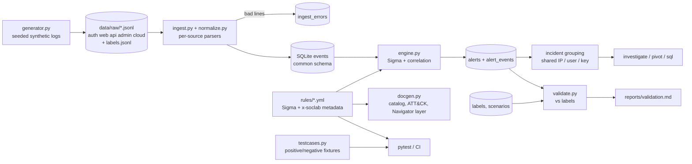

# Architecture

## Components
| Component | Role |
|---|---|
| `generator.py` | Deterministic (seed 1337) baseline + attack, evasion and hard-negative scenarios. Native log shapes differ per source. |
| `normalize.py` / `ingest.py` | Map each source onto the common schema (`schema.py`), derive `hour_utc`, `self_action`, `public_exposure`; quarantine malformed lines. |
| `sigma.py` | Sigma-subset evaluator (modifiers, wildcards, boolean conditions, `1 of x*`). |
| `engine.py` | `event_count`, `value_count`, `temporal_ordered` correlations with burst merging; builds alerts and incidents. |
| `validate.py` | Scenario/rule-level TP, FP, FN from labels. |

## Alert and incident model
Alert: `alert_id, rule_id, severity (+reason), first/last_seen, entities, explanation, mitre, runbook, evidence ids + sample, timeline`.
Severity = rule level, +1 for privileged (`adm-*`/root) accounts when the rule opts in. Incident = alerts sharing a user, external IP or API key within 2 h; +1 severity when three or more tactics are involved.

## Schema extension for Sigma
Rules use the lab's field names (`src_ip`, `user`, `hour_utc` ...) rather than vendor fields; mapping from native logs lives in `normalize.py`. Lab metadata sits under `x-soclab` (rule_id, explanation template, runbook, tuning, limitations, `alert: false` for helpers). Sigma correlation documents follow the Sigma correlation spec shape; the evaluator is a subset, not a conformant backend.
